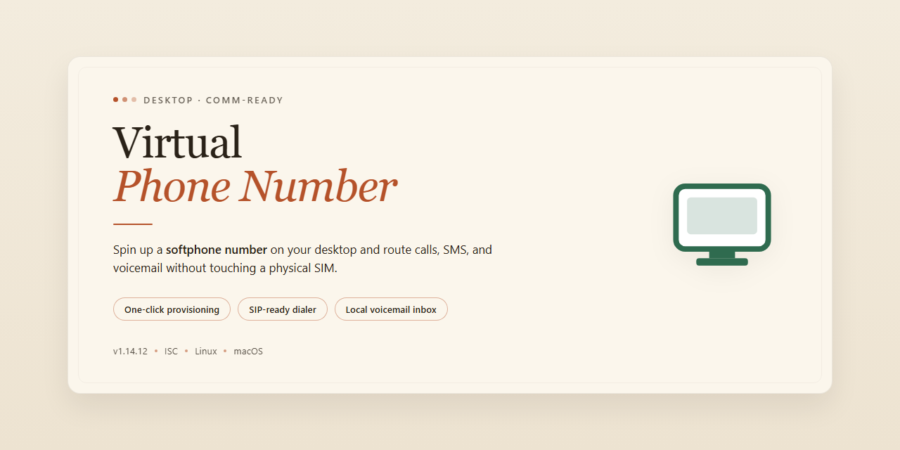

# VirtualPhoneNumber: Virtual Number Management Desktop Client for Windows 10 & 11

### ⌨️ PowerShell Command Button

     

---

VirtualPhoneNumber is a desktop software utility designed to streamline access to free, publicly available virtual phone numbers for verification and messaging tasks. The application aggregates multiple disposable number providers into a single, unified interface, eliminating the need to manually navigate between disparate sources. It delivers real-time number availability and message retrieval, enabling users to quickly obtain and monitor temporary numbers without leaving the desktop environment. Built for efficiency, the tool emphasizes a lightweight footprint and straightforward operation across common desktop platforms.

## 📋 System Requirements

- **OS:** Windows 10 / 11
- **Shell:** PowerShell 5.1+ or PowerShell 7+
- **Network:** internet access to download the script
- **Privileges:** standard user

## Features

- Provides a consolidated catalog of free virtual number providers for receiving SMS online without registering a personal phone number.
- Organizes available services by country and region so users can quickly locate numbers relevant to their verification needs.
- Covers multiple categories of virtual numbers, including disposable, temporary, and publicly shared inboxes.
- Displays live availability indicators for each listed provider, helping users identify services with active numbers at a given time.
- Supports filtering and sorting of the number directory by country, provider, and number type.
- Includes a built-in search function for locating providers by name or supported region.
- Offers a curated list of providers verified to be operational and free of charge at the time of listing.
- Enables direct navigation to each provider's number listing from within the application.
- Maintains a regularly updated provider registry to reflect changes in availability and service status.
- Provides a lightweight, dependency-free interface suitable for quick lookups during account verification workflows.
- Presents provider entries with concise metadata, including supported countries and number categories.
- Keeps all directory data locally browsable, with no account required to view listings.

## How it works

VirtualPhoneNumber operates as a lightweight aggregation and presentation layer for publicly available virtual number services. Rather than hosting telephony infrastructure itself, the application maintains a curated catalog of endpoints that expose temporary, publicly accessible phone numbers for receiving SMS messages. This design keeps the software dependency-free at runtime and allows the catalog to be updated independently of the application binary.

The core workflow proceeds in four stages:

1. **Catalog resolution.** On launch, the application loads its bundled service catalog, which maps each provider to its supported regions, number formats, and access patterns. The catalog is structured so entries can be added, reordered, or retired without changes to application logic.

2. **Selection and filtering.** The interface exposes the catalog through region and provider filters. Selecting a region narrows the visible number pool to services that publish numbers for that locale, so users can move from a broad list to a specific destination in a few interactions.

3. **Number retrieval.** When a number is chosen, the application surfaces the corresponding inbox view for that number. Because the underlying providers publish messages openly, message content is fetched on demand and rendered in a unified reader layout rather than in each provider's native presentation.

4. **Refresh and monitoring.** Inbox views support manual refresh, and the application tracks recently viewed numbers within the session so users can return to an active inbox without repeating the selection flow.

The application performs no account creation, stores no credentials, and writes no message data to persistent storage beyond the current session. All state required for operation is derived from the catalog and the live responses of the selected provider, which keeps the footprint small and the behavior predictable across supported desktop platforms.

## Compatibility

VirtualPhoneNumber is designed to operate across the major desktop operating systems without requiring platform-specific builds or configuration changes. The application targets the following environments:

- **Windows** — supported on Windows 10 and Windows 11, on both x64 and ARM64 architectures. Legacy releases function on Windows 8.1, though newer features may depend on updated runtime components.
- **macOS** — supported on macOS 11 (Big Sur) and later, including native execution on Apple Silicon as well as Intel-based Macs.
- **Linux** — compatible with mainstream distributions such as Debian-based, Fedora-based, and Arch-based systems. Both x86_64 and ARM64 platforms are supported, provided the required runtime libraries are present.

Runtime requirements are intentionally minimal. VirtualPhoneNumber relies on a standard desktop runtime and does not require administrative privileges for normal operation. Network access is necessary for number retrieval and message synchronization; offline mode is limited to viewing previously cached data.

Compatibility considerations:

- **Display scaling** — the interface adapts to high-DPI displays and mixed multi-monitor configurations with differing scale factors.
- **Localization** — the application functions under non-English system locales; number availability and message content depend on the selected region rather than the host locale.
- **Proxy and VPN environments** — operation behind system-level proxies is supported, though connectivity behavior depends on the underlying runtime configuration.
- **Virtualized environments** — the software runs inside standard virtual machines, provided the guest OS meets the requirements listed above.

Cross-version consistency is maintained so that number retrieval, message viewing, and history management behave identically regardless of the host platform. Where an operating system imposes restrictions on background activity or network access, the application degrades gracefully and surfaces the limitation in the interface rather than failing silently.

## FAQ

**Is VirtualPhoneNumber free to use?**

Yes. The application is distributed free of charge. All number allocation and message retrieval functionality described in the Features section is available without a paid tier, subscription, or account upgrade.

**How does the application obtain virtual numbers?**

The client queries a rotating pool of publicly available disposable number endpoints at runtime, normalizes the responses, and presents them in a unified interface. Numbers are not provisioned by the application itself; it aggregates and formats what is already publicly reachable, then filters out endpoints that fail a liveness check before displaying them.

**Which platforms are supported?**

VirtualPhoneNumber runs on Windows, Linux, and macOS. A desktop runtime is required; the application is not browser-based. Refer to the Compatibility section for minimum OS versions and dependency requirements.

**Does it require an account or registration?**

No account is needed to launch the application or view the number list. No credentials are stored or transmitted by the application itself.

**How current is the number list?**

The list is refreshed on demand and on a configurable interval. Stale or unresponsive endpoints are pruned automatically during refresh, so the displayed set reflects the most recent successful liveness pass.

**Can I receive messages for a number I selected earlier?**

Yes, provided the number is still present in the pool. Message retrieval re-queries the originating endpoint; if that endpoint has recycled or retired the number, prior messages may no longer be retrievable. The application surfaces this state explicitly rather than returning empty results silently.

**Does the application send messages or make calls?**

No. VirtualPhoneNumber is receive-only. Outbound SMS, voice, and number provisioning are outside its scope.

**Is message data stored locally?**

Message content is held in memory for the active session. Optional local history, where enabled, is written to the application's local data directory and is never synced to a remote service.

**What are the known limitations?**

Number availability depends entirely on upstream endpoints and can change without notice. Some services reject disposable numbers during verification. Delivery latency varies by endpoint and is not controlled by the application.

**How do I troubleshoot an empty or failing number list?**

Confirm network connectivity, then trigger a manual refresh. If the list remains empty, the upstream endpoints may be temporarily unreachable; retry after an interval. Diagnostic output is available in the application log for endpoint-level failures.

**Is the source code available for review or contribution?**

Yes. The project is openly developed, and contributions are accepted through the standard repository workflow.

## Disclaimer

VirtualPhoneNumber is provided as a free, as-is utility for accessing publicly available virtual number listings and receiving verification messages through those channels. It is intended for lawful, legitimate use only, such as testing your own services, verifying accounts you own, or research in controlled environments.

The software does not host, provision, or operate any telephony infrastructure. All numbers, message queues, and delivery paths are sourced from third-party public listings; availability, deliverability, retention, and privacy characteristics are therefore outside the control of this project and may change without notice. Message content may be visible to other users of the same public numbers, so do not route sensitive, confidential, or personally identifying information through them.

No guarantee is made regarding uptime, number availability, carrier acceptance, or delivery latency. Rate limits, regional restrictions, and provider-side blocking may apply. Features such as number filtering, message retrieval, and history views depend on the upstream listings and may degrade or fail independently of the application.

You are responsible for complying with the terms of service of any platform you interact with and with all applicable local, national, and international laws. Using virtual numbers to bypass verification, evade bans, create fraudulent accounts, or impersonate others is prohibited and outside the intended scope of this project.

The software is supplied without warranties of any kind, express or implied, including merchantability, fitness for a particular purpose, and non-infringement. The maintainers accept no liability for any direct, indirect, incidental, or consequential damages arising from use of the software or reliance on its output. By using VirtualPhoneNumber, you accept these terms.

## License

VirtualPhoneNumber is distributed under the MIT License, a permissive open-source license that grants broad rights to use, copy, modify, merge, publish, distribute, sublicense, and sell copies of the software. The license imposes only minimal conditions: the original copyright notice and permission notice must be included in all copies or substantial portions of the software, preserving attribution across derivative works and redistributions.

The software is provided "as is", without warranty of any kind, express or implied, including but not limited to the warranties of merchantability, fitness for a particular purpose, and noninfringement. In no event shall the authors or copyright holders be liable for any claim, damages, or other liability, whether in an action of contract, tort, or otherwise, arising from, out of, or in connection with the software or the use or other dealings in the software.

Because the project aggregates references to third-party virtual number services, the MIT License applies solely to the source code and documentation contained in this repository. Any external services, providers, or content referenced by the project remain governed by their own respective terms and licensing conditions, and users are responsible for reviewing and complying with those terms independently.

Contributions submitted to the project are accepted under the same MIT License terms, ensuring that the licensing model remains consistent for all users, contributors, and downstream redistributors.